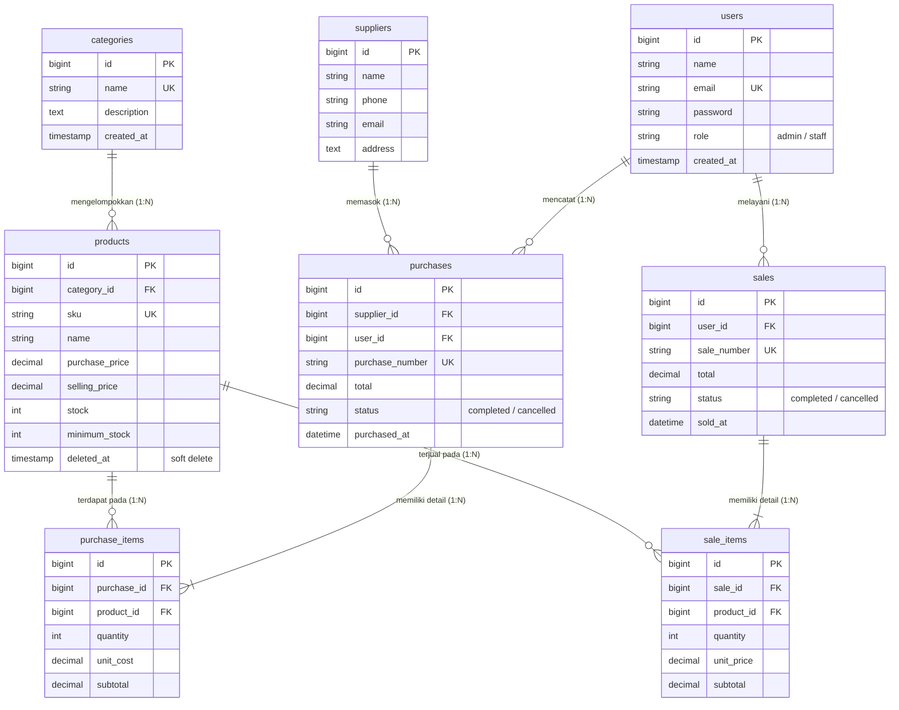

# Integrated Laravel Project: Inventory & Sales Management System
> **UJIAN TENGAH SEMESTER (UTS) - WEB PROGRAMMING 2**  
> Sistem Manajemen Inventaris, Pengadaan Stok (*Stock-In*), dan Kasir Penjualan (*Stock-Out*) Terintegrasi.

---

## 📌 1. Project Overview

Aplikasi ini adalah sistem bisnis terintegrasi yang dibangun untuk mendistribusikan produk, mengelola data pemasok (*suppliers*), menangani pengadaan stok (*purchases*), serta mencatat transaksi penjualan (*sales*) melalui kasir dengan pembatasan hak akses (*Role-Based Access Control* / RBAC).

### Nilai Utama & Solusi Bisnis:
1. **Konsistensi Stok Real-time:** Stok bertambah saat pengadaan (*purchase*) dan berkurang saat transaksi penjualan (*sale*) berhasil.
2. **Pencegahan Overselling & Concurrency Locking:** Menggunakan `Product::lockForUpdate()` dan validasi server-side agar produk tidak dapat terjual melebihi stok fisik yang tersedia sekalipun terjadi transaksi bersamaan.
3. **Integritas Transaksi Atomik:** Menggunakan `DB::transaction` pada setiap transaksi multi-item; jika terjadi satu item gagal atau stok kurang, seluruh transaksi otomatis dibatalkan (*rollback*) tanpa meninggalkan data sampah atau data setengah tersimpan.
4. **Proteksi Harga Server-Side:** Harga satuan dan total transaksi dihitung murni di server dari database, tidak mempercayai manipulasi input browser.
5. **Perlindungan Data Sensitif:** Menerapkan pembatasan role *Admin/Owner* vs *Staff* di tingkat server melalui Middleware & Gate, serta mencegah *hard delete* pada produk dan master data yang memiliki riwayat transaksi (menggunakan *Soft Deletes*).

---

## 🛠️ 2. Persyaratan Sistem & Tech Stack

* **PHP:** >= 8.1
* **Framework:** Laravel 10.x
* **Database:** MySQL 8.x
* **Web Server:** Apache / Nginx / PHP Built-in Server (`php artisan serve`)
* **Dependency Manager:** Composer 2.x
* **Frontend:** Blade Templating, Tailwind CSS, Font Awesome 6

---

## 🚀 3. Panduan Instalasi Langkah-demi-Langkah (Reproducible Setup)

Dosen atau penilai dapat menguji dan menjalankan aplikasi ini pada komputer bersih dengan langkah-langkah berikut:

```bash
# 1. Clone repository ke komputer lokal
git clone https://github.com/nurfatma7082-gif/inventory-laravel.git
cd inventory-laravel

# 2. Install dependensi Composer
composer install

# 3. Salin file environment
cp .env.example .env

# 4. Generate App Encryption Key
php artisan key:generate

# 5. Konfigurasi kredensial database di file .env
# Sesuaikan DB_DATABASE, DB_USERNAME, dan DB_PASSWORD

# 6. Jalankan migrasi dan seeder data awal
php artisan migrate --seed

# 7. Jalankan server lokal Laravel
php artisan serve
```

Aplikasi kini dapat diakses melalui browser di: `http://127.0.0.1:8000` atau `http://localhost:8000`.

---

## ⚙️ 4. Konfigurasi Environment (`.env`)

Pastikan baris konfigurasi database pada file `.env` telah disesuaikan:

```env
DB_CONNECTION=mysql
DB_HOST=127.0.0.1
DB_PORT=3306
DB_DATABASE=inventory_laravel_db
DB_USERNAME=root
DB_PASSWORD=
```

> **Catatan Keamanan:** File kredensial asli `.env` diabaikan oleh `.gitignore` dan tidak boleh di-commit ke repository publik. File `.env.example` disediakan sebagai acuan konfigurasi.

---

## 🔑 5. Akun Demo untuk Pengujian

Database Seeder telah menyiapkan 2 akun siap pakai dengan hak akses berbeda:

| Role | Email Login | Password | Hak Akses Utama |
| :--- | :--- | :--- | :--- |
| **Admin / Owner** | `admin@inventory.com` | `password123` | Akses penuh: Kelola Pengguna, CRUD Kategori, CRUD Pemasok, CRUD Produk, Lihat semua transaksi, Batalkan transaksi (*restore stock*), Dashboard laporan lengkap. |
| **Staff Kasir** | `staff@inventory.com` | `password123` | Transaksi Pembelian (*Stock-In*), Transaksi Penjualan (*Stock-Out*), Lihat Katalog Produk & Stok, Melihat Detail Transaksi. Ditolak jika mencoba mengakses halaman kelola user atau CRUD master data via URL langsung. |

*(Tersedia tombol satu-klik pada formulir login untuk mengisi kredensial demo secara instan).*

---

## 📊 6. Entity Relationship Diagram (ERD) & Struktur Database



### Penjelasan Relasi Eloquent:
* **`Category hasMany Products` / `Product belongsTo Category`**: Satu kategori dapat menaungi banyak produk. Foreign key `category_id` diletakkan pada tabel `products`.
* **`Supplier hasMany Purchases` / `Purchase belongsTo Supplier`**: Pemasok dapat memiliki banyak riwayat pengadaan. Foreign key `supplier_id` ada pada tabel `purchases`.
* **`Purchase hasMany PurchaseItems` / `PurchaseItem belongsTo Purchase`**: Satu transaksi pengadaan memuat satu atau lebih item barang belanjaan. Foreign key `purchase_id` diletakkan pada detail item (`purchase_items`).
* **`Sale hasMany SaleItems` / `SaleItem belongsTo Sale`**: Transaksi penjualan kasir menampung berbagai macam barang belanjaan konsumen. Foreign key `sale_id` berada di tabel `sale_items`.
* **`Product hasMany PurchaseItems & SaleItems`**: Satu produk dapat tercatat di berbagai histori pembelian dan penjualan.

---

## 💡 7. Business Rules & Implementasi Teknis

1. **Pencegahan Overselling & Database Concurrency Locking:**
   Saat pemrosesan penjualan, baris data produk dikunci secara pesimis menggunakan:
   ```php
   $product = Product::lockForUpdate()->findOrFail($item['product_id']);
   if ($qty < 1 || $product->stock < $qty) {
       throw ValidationException::withMessages([
           'items' => "Stok produk '{$product->name}' tidak mencukupi (Tersedia: {$product->stock}, Diminta: {$qty}).",
       ]);
   }
   ```
2. **Kalkulasi Total Transaksi di Sisi Server:**
   Aplikasi tidak mempercayai harga jual atau subtotal yang dikirim dari browser. Server membaca harga satuan `selling_price` resmi langsung dari database dan menghitung `subtotal` serta `total` belanjaan.
3. **Database Transaction (Atomicity):**
   Seluruh pembuatan header faktur, iterasi detail item, kalkulasi total, dan mutasi perubahan stok dibungkus dalam `DB::transaction(function() { ... })`. Jika salah satu baris item bermasalah, seluruh transaksi di-*rollback* secara instan.
4. **Pembatalan Transaksi Terkendali (*Cancellation Rules*):**
   * Pembatalan Penjualan: Mengembalikan (*increment*) stok barang ke sistem.
   * Pembatalan Pembelian: Memeriksa ketersediaan stok fisik saat ini, lalu mengurangi (*decrement*) stok barang yang ditarik.
5. **Perlindungan Master Data (Soft Delete & Restrict):**
   Produk yang sudah pernah memiliki riwayat transaksi tidak dapat di-*hard delete* (menggunakan *soft delete* agar riwayat faktur masa lalu tidak rusak). Kategori dan supplier yang masih terikat transaksi dilindungi dari penghapusan.

---

## 🛡️ 8. Server-Side Authorization (RBAC)

Sistem mengamankan endpoint secara mutlak di tingkat server:
* Menggunakan middleware kustom `CheckRole` yang terdaftar sebagai alias `role` di `app/Http/Kernel.php`.
* Penggunaan Gate (`manage-users`, `manage-master-data`, `cancel-transaction`, `manage-sales`, `manage-purchases`) di `AuthServiceProvider.php`.
* Jika pengguna berstatus **Staff** mencoba mengetikkan URL route Admin secara langsung (misal: `/users`, `/categories/create`, atau memicu `/products/{id}` DELETE via Postman/cURL), server akan langsung memblokir dengan kode status **`403 Forbidden`**.

---

## 🧪 9. Pengujian Otomatis (Automated Tests)

Aplikasi telah dilengkapi unit test dan feature test komprehensif (`tests/Feature/`) untuk memvalidasi semua skenario pengujian:

Jalankan perintah pengujian:
```bash
php artisan test
```

### Hasil Uji (19 Passed / 55 Assertions):
* `AuthTest`: Pengalihan guest ke login, autentikasi sukses, penolakan password salah, fungsi logout.
* `AuthorizationTest`: Pemblokiran akses Staff ke manajemen user (403), pelarangan Staff membuat kategori (403), pelarangan Staff menghapus produk (403), verifikasi Staff dapat bertransaksi.
* `ProductTest`: Validasi keunikan SKU produk, penolakan harga dan stok bernilai negatif.
* `PurchaseTransactionTest`: Transaksi pengadaan menambah stok otomatis, pembatalan pembelian mengoreksi stok kembali.
* `SaleTransactionTest`: Transaksi penjualan mengurangi stok, server menghitung total harga, transaksi dengan stok kurang ditolak tanpa mengubah data, atomisitas *rollback* multi-item, dan pembatalan penjualan memulihkan stok.

---

## 🎓 10. Persiapan Code Ownership & Tanya Jawab Ujian

Berikut adalah penjelasan teknis untuk pertanyaan wawancara dosen (Slide 24):

1. **Mengapa `Sale` memiliki relasi `hasMany` ke `SaleItem`?**  
   *Jawaban:* Satu transaksi penjualan dapat memuat lebih dari satu jenis produk dengan kuantitas dan harga berbeda dalam satu struk belanja. Pola desain Header-Detail memisahkan metadata transaksi (nomor faktur, kasir, waktu) di tabel `sales` dan rincian tiap barang di tabel `sale_items`.

2. **Di mana sistem memastikan stok tidak menjadi negatif?**  
   *Jawaban:* Pada method `store()` di `SaleController.php`, sebelum fungsi `decrement('stock', $qty)` dijalankan, terdapat validasi `if ($product->stock < $qty)`. Jika tidak cukup, sistem melempar `ValidationException` sehingga operasi dihentikan sebelum stok tersentuh.

3. **Mengapa total penjualan dihitung di server?**  
   *Jawaban:* Input dari browser (JavaScript / DevTools) sangat mudah dimanipulasi oleh pihak yang tidak bertanggung jawab. Menghitung harga dari database di server menjamin integritas finansial bisnis.

4. **Apa risiko jika pengurangan stok dilakukan di luar `DB::transaction`?**  
   *Jawaban:* Risiko inkonsistensi data (*partial failure*). Jika terjadi error (misalnya pemadaman server atau foreign key error) setelah stok produk pertama dikurangi namun sebelum faktur penjualan tersimpan, stok fisik akan hilang di sistem tanpa ada bukti transaksi tercatat.

5. **Bagaimana mencegah Staff mengakses fungsi Admin melalui URL langsung?**  
   *Jawaban:* Menyembunyikan tombol UI saja tidak cukup. Route Admin dilindungi di `routes/web.php` menggunakan middleware `role:admin`. Middleware memeriksa `auth()->user()->role === 'admin'`. Jika tidak sesuai, request langsung di-abort dengan kode respon `403 Forbidden`.

6. **Apa yang terjadi jika dua penjualan memproses stok produk yang sama hampir bersamaan (*Race Condition*)?**  
   *Jawaban:* Tanpa penguncian, kedua transaksi bisa membaca stok yang sama secara bersamaan sehingga terjadi penjualan melebihi batas (*overselling*). Sistem kami mengatasinya dengan `Product::lockForUpdate()` (pessimistic locking) yang menahan baris data produk hingga transaksi pertama selesai (*commit*), baru transaksi kedua diizinkan membaca stok terkini.

7. **Tunjukkan validasi SKU unik dan jelaskan peran constraint database!**  
   *Jawaban:* Di `ProductController.php` divalidasi dengan `'sku' => ['required', 'unique:products,sku']`. Di level database migration, kolom didefinisikan dengan `$table->string('sku', 50)->unique();`. Constraint database menjamin tidak ada duplikasi data meskipun terjadi bypass validasi aplikasi.

8. **Ubah aturan minimum stock dan tunjukkan dampaknya!**  
   *Jawaban:* Nilai `minimum_stock` dapat diubah pada form master produk. Scope `Product::lowStock()` (`whereColumn('stock', '<=', 'minimum_stock')`) di `Product.php` akan otomatis mendeteksi produk tersebut dan menampilkannya pada tabel peringatan *Low-Stock Alert* di Dashboard.

---

## 📄 11. Batasan Sistem (Known Limitations)

* Menggunakan mata uang Rupiah (IDR) tunggal (*Single Currency*).
* Sistem dirancang untuk satu gudang distribusi utama (*Single Warehouse*).
* Integrasi pembayaran menggunakan sistem pencatatan tunai/transfer internal tanpa payment gateway pihak ketiga (sesuai batasan soal UTS).
